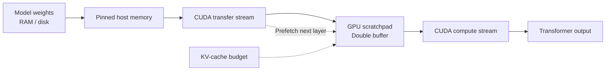

<div align="center">

# PRATHMESH CHAVAN

### AI Engineer | LLM Inference | Machine Learning | AI Systems

**Designing and building AI systems, from model inference and optimization to production-facing applications.**


[](https://prathmeshhchavan.vercel.app/)
[](https://linkedin.com/in/prathmesh-chavan-055556378)
[](mailto:prathmeshc002@gmail.com)

<sub>Bengaluru, India · Open to AI / ML engineering opportunities</sub>

</div>

---

## About

I build **AI-powered applications and developer tools**, with particular interest in **LLM inference, memory-efficient model execution, computer vision, and reliable backend services**.

My work spans machine learning experiments, application architecture, model integration, API development, and deployment. I'm particularly interested in making advanced AI systems more practical on limited compute.

```text
FOCUS       LLM inference · Applied ML · Computer vision
ENGINEERING Python · PyTorch · TensorFlow · FastAPI
BUILDING    AI developer tools · Intelligent applications
INTERESTS   Memory optimization · Agent systems · Deployment
```

## Featured work

### 01 / StreamLLM — Memory-Efficient LLM Inference

**[Explore repository](https://github.com/prathamc00/streamLLM)** · **[PyPI package](https://pypi.org/project/streamllm/)**

A Python package designed to run large language models with constrained GPU memory by **streaming transformer layers between host memory/storage and GPU VRAM** rather than keeping the entire model resident in VRAM.

- Layer-wise execution with **asynchronous prefetching and double buffering**
- Dedicated **CUDA compute and transfer streams** with event synchronization
- **Pinned host memory**, reusable GPU scratchpad buffers, and KV-cache budgeting
- Python SDK and CLI for model installation, interactive inference, and benchmarking

**Stack:** `Python` `PyTorch` `CUDA` `LLM Inference` `GPU Memory Optimization`

> Designed for resource-constrained inference. See the repository for supported models, requirements, benchmarks, and current limitations.

#### Inference architecture



#### Published layer-streaming benchmark

Measured on an **NVIDIA RTX 3050 Laptop GPU (4 GB VRAM)**. The reported timings compare sequential layer transfer/execution against asynchronous prefetching in a streaming microbenchmark; **they are not full-model tokens/second measurements**.

| Layers | Sequential | Prefetch | Speedup | GPU scratchpad |
| :-- | --: | --: | --: | --: |
| 8 | 68.08 ms | 56.70 ms | 1.20× | 128 MB |
| 16 | 136.51 ms | 126.11 ms | 1.08× | 128 MB |
| 24 | 219.05 ms | 170.54 ms | **1.28×** | 128 MB |
| 32 | 278.85 ms | 265.03 ms | 1.05× | 128 MB |

[Benchmark details and methodology](https://github.com/prathamc00/streamLLM#benchmark-performance) · [Quickstart](https://github.com/prathamc00/streamLLM#quickstart)

### 02 / Deepfake Detection — AI-Powered Media Analysis

**[Explore repository](https://github.com/prathamc00/Deepfake-detection-usingAI)**

A deepfake detection application for analyzing image and video content, organized as a **FastAPI backend and React/TypeScript frontend**, with Docker-based local setup.

**Stack:** `Python` `FastAPI` `React` `TypeScript` `Computer Vision`

### 03 / AI Code Reviewer — Hybrid Static and LLM Analysis

**[Explore repository](https://github.com/prathamc00/AI-Code-Reviewer)**

A code review tool combining deterministic **Python AST/static analysis** with LLM-assisted reasoning to identify issues and produce actionable review feedback.

**Stack:** `Python` `FastAPI` `Groq API` `LLMs` `React`

### 04 / Facial Recognition System — Real-Time Vision

**[Explore repository](https://github.com/prathamc00/Facial-recognition-system-)**

A computer vision system with real-time face recognition, **MobileNetV2-based learning**, liveness detection, and attendance tracking.

**Stack:** `Python` `TensorFlow` `OpenCV` `MobileNetV2`

### 05 / InboxAlert — AI-Assisted Email Triage

**[Explore repository](https://github.com/prathamc00/InBox-AleRt)**

An intelligent inbox monitoring project that combines email integrations, importance scoring, and WhatsApp notifications for priority messages.

**Stack:** `Python` `Gemini` `API Integrations` `Automation`

---

## Technical stack

| Domain | Tools and technologies |
| :-- | :-- |
| **AI & deep learning** | Python, PyTorch, TensorFlow, scikit-learn, OpenCV |
| **LLM engineering** | Transformer inference, CUDA streaming, model optimization, LLM APIs |
| **Backend engineering** | FastAPI, Flask, REST APIs |
| **Applications** | React, TypeScript, JavaScript, HTML, CSS |
| **Data & development** | NumPy, Pandas, Git, GitHub, Docker |

## Professional experience

**Crismatec — Software Development / AI Integration**  
*December 2024 – Present*

- Contributed to a **Student Learning Portal**, developing interfaces and connecting them to backend APIs.
- Worked on integrating **AI-powered learning workflows**, including personalized learning support, quiz generation, and assessment-related features.
- Collaborated with the development team on integration testing, troubleshooting, and application improvements.

> Interested in the intersection of applied AI, software engineering, and resource-efficient inference systems.

## Engineering interests

**Inference performance** — reducing peak GPU memory requirements and studying latency / throughput tradeoffs.

**Practical AI systems** — integrating models into useful, maintainable applications with APIs and clear interfaces.

**Agentic software** — exploring tool-using AI workflows, automation, and developer productivity.

## More repositories

For implementations, experiments, and development history, visit the [repositories tab](https://github.com/prathamc00?tab=repositories). Selected work is highlighted above.


---

<div align="center">

### Let's build something useful.

**Open to AI Engineering, Machine Learning, and applied AI collaborations.**

[Portfolio](https://prathmeshhchavan.vercel.app/) &nbsp;·&nbsp; [LinkedIn](https://linkedin.com/in/prathmesh-chavan-055556378) &nbsp;·&nbsp; [Email](mailto:prathmeshc002@gmail.com)

<sub>BUILD. MEASURE. OPTIMIZE. SHIP.</sub>

</div>
